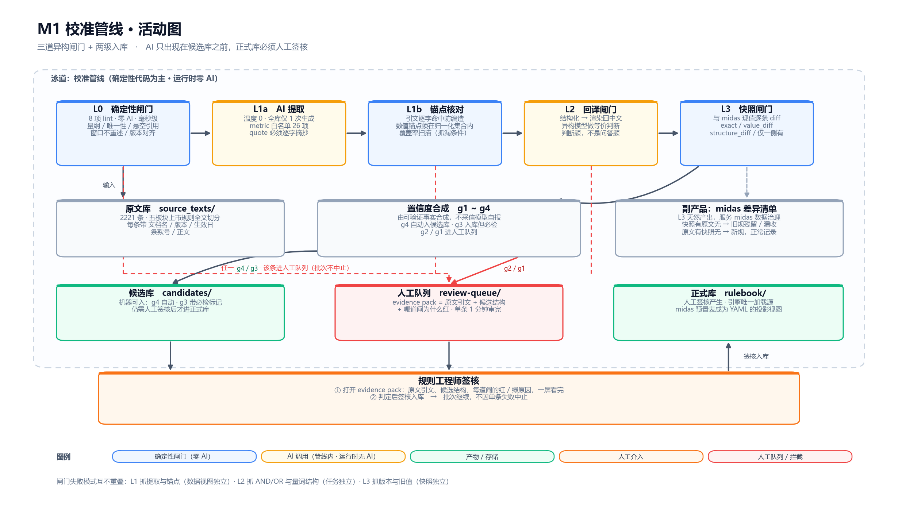

# 设计 0003：校准管线（AI 辅助 + 异构闸门 + 人工签核）

- 日期：2026-11-10
- 性质：未决 **#5（校准工作流）** 的方案定稿；D4「人工校准」环节的修订（[ADR-0005](../adr/0005-ai-assisted-calibration.md)）
- 输入：[calibration/0001](../calibration/0001-set-inventory.md)（5 类实锤错误 + 43 套黄金集）、[评审 0003](../reviews/0003-requirement-assessment.md)（S6 / S9~S11 数据治理）、G-A lint 清单（CONTEXT #3）
- 拍板：**2026-11-10，R1~R11 全部按推荐通过**（记录见 §12）

---

## 0. 定位与「三票」重构

- **解决的问题**：规则库数据质量。midas 侧已实锤 5 类错误（calibration/0001 §3：350亿笔误 / 2.5 单位错 / 旧值残留 / 序号重复 / 下钻参数错），且无任何机器防线。
- **原案与重构**：原案「每条标准三次投票调用、全过才入库、一票否决中止」。已论证：**同模型三连投对 5 类已知错误零捕获**（相关性——同一个考官连问三遍同一个考生，口误会重复出现），且 LLM 正常抖动会把人工队列撑爆、诱发审核放水。重构为**三道异构闸门 + 两级入库**（R1/R2/R3）。
- **AI 的位置**：只在候选库之前（提取 / 判断），正式库只能由人工签核产生。与 D3 不冲突——引擎运行时零 AI；校准管线与第四层叙述 agent 同属「外部 AI 豁免口」。
- **输出物**：#3 规则库 YAML 的实例 + **midas 存量差异清单**（L3 副产品，直接服务 midas 侧数据治理）。

## 1. 设计总则：独立性从哪来

「异构」= 三道闸的**失败模式互不重叠**。独立性三个来源，每道闸至少占一个：

| 独立性来源 | 含义 | 谁在用 |
|---|---|---|
| 数据视图独立 | 看不同的东西：法规原文 / 结构化候选 / midas 快照 | L1、L3 |
| 任务独立 | 干不同的活：提取（生成）vs 回译判断（NLI） | L1 vs L2 |
| 模型独立 | 不同模型（最好异厂商） | L2 执行者（R5/R8，配置项） |

模型独立是**最弱**的一种（两个大模型在歧义句上会犯同样的错），设计上优先用前两种。

## 2. 管线全景



> 图源：`assets/m1-calibration-pipeline.py`（matplotlib 自绘，可直接改常量重出图）与
> `assets/m1-calibration-pipeline.dot`（Graphviz 版，供需要纯线条图的场合）。
> 蓝色 = 确定性闸门（零 AI）· 橙色 = AI 调用 · 绿色 = 产物 · 橙框 = 人工 · 红 = 拦截。

文字版流程（与图一一对应）：

```
原文库（每条带：文档名/版本/生效日/条款号/正文）
   │
   ▼
【L0 确定性闸门】 零 AI，毫秒级，不过 = 绝对拦截
   ▼
【L1 提取闸门】  AI 提取 1 次 + 锚点核对（确定性）
   │   产出：候选规则 JSON + 支撑引文
   ▼
【L2 回译闸门】  AI 判断 1 次（异构模型执行）
   │   渲染回中文 → 与原文比语义
   ▼
【L3 快照闸门】  与 midas 现值 diff（确定性）
   │
   ├─ 全绿 ────────────→ 候选库（机器可入）
   └─ 任一红 ──────────→ 人工队列（evidence pack，批次继续）
候选库 ──人工签核──→ 正式库（唯一可被引擎加载）
```

**作用粒度 = clause（条文）级**（R7）：185 条文，平均 1.3 叶 ≈ 240 个数值锚点。不是套级（失败定位难）也不是单叶（丢上下文，模型看不懂「均为正且累计」）。**短路执行**：L0/L1b 毫秒级先行，L2 只对前面全过者调用。

## 3. L0 确定性闸门（零 AI）

| # | 检查项 | 抓什么 | 已知案件 |
|---|---|---|---|
| 0-1 | Schema 合法（字段/枚举：op、quantifier、window 取值域） | 结构垃圾 | — |
| 0-2 | **量纲一致**：同 metric 阈值换算后同单位（元/小数） | 单位错 | 2.5 vs 2.5亿 ✓ |
| 0-3 | 唯一性：group+branch+clause、sort 不重复 | 转写重复 | 序号 4 重复 ✓ |
| 0-4 | 引用完整：metric_ref ∈ metric_definitions；evidence_ref 非空 | 悬空引用 | — |
| 0-5 | **窗口不重述**：leaf 只有 quantifier+window 枚举，禁手写区间 | 同语义不同参数 | check04/11 ✓ |
| 0-6 | 结构完整：每套 ≥1 clause；同 group 各 branch 共享公共条文 | 转写噪音 | 主板 sort1/2 ✓ |
| 0-7 | 组合覆盖：每个 (board, company_type) 有套或显式声明无套 | 漏配静默空集 | — |
| 0-8 | **版本对齐**：evidence_ref 指向文档版本 = as_of_date 时点现行版 | 旧值残留 | 表决权差异门槛 ✓ |

> 0-2/0-4/0-5/0-7 即评审 0003 交叉对照产出的 **G-A lint 五条**归位（CONTEXT #3 已引用）；引擎运行时的「适用套为空 → 显式报错」也由 0-7 承诺。L0 拦截的条目不进 AI，直接带原因进人工队列。

## 4. L1 提取闸门：一次生成 + 一次确定性锚点核对

**L1a AI 提取**（管线唯一的生成调用，温度 0）：

```
输入：条文正文（含条款号、版本元数据）
     + metric_ref 白名单（24 条件型，受约束分类，禁止自由发明指标）
     + 输出 JSON Schema（对齐 #3 规则库：leaf/clause/branch + evidence）
要求：quote 字段 = 支撑引文，必须逐字摘抄原文
```

**L1b 锚点核对**（确定性，三步）：

1. **引文防编造**（R9 强制）：quote 必须在原文中逐字命中（substring）。编造引文 = 幻觉直接证据，立即拦截——这是后续锚点的地基。
2. **数值锚点**：候选规则用到的每个数值 ∈ 引文归一化数值集合。归一化规则表冻结为 YAML 配置（R10）：

| 原文形态 | 归一化 |
|---|---|
| 五十亿 / 50亿元 / 50 亿 | 5.0e9（元） |
| 5000万 | 5.0e7 |
| 15% / 百分之十五 | 0.15（小数） |
| 不低于 / 不少于 / ……以上 | GE |
| 高于 / 超过 / 大于 / 逾 | GT |
| 均为正（各年度均为正） | quantifier=all_periods + GT 0 |

3. **覆盖率**（抓漏条件）：正则扫引文中「不低于|不少于|超过|高于|大于|达到 + 数字」模式，引文有阈值型模式而候选未使用 → 疑似漏提取警告进人工。漏提取是 L1 最大漏放风险，此步是 L1 层唯一抓手。

## 5. L2 回译闸门：最关键的一道

**为什么不用「第二模型重提取再 diff」**：两个模型对同一句歧义话做提取，容易错得一样（尤其 AND/OR 嵌套处）。改用**回译验证**——把结构化候选用确定性模板渲染回中文，让模型做**判断题**（NLI）而不是再做一遍**问答题**。任务类型彻底不同，是最强的任务独立性。

**渲染器**（纯代码模板，非 LLM）：

```
leaf:  sum, last_3_years, 净利润, GE, 2亿  → "最近三个会计年度净利润累计不低于2亿元"
leaf:  all_periods, GT, 0                  → "最近三个会计年度各年净利润均为正"
clause logic=any → "满足下列条件之一：(A)；或 (B)"
clause logic=all → "同时满足：(A)，且 (B)"
```

**判断任务**（第二次 AI 调用，异构模型执行，R8）：

```
输入：原文条款 + 渲染文本
输出：{equivalent: yes|no|partial, differences: ["..."]}
```

> AND/OR 嵌套错是**最危险的错误类**：数字层完全无感（2亿、15亿都在引文里），只有回译能抓。此错入库的后果：甲公司（现金流 1.8 亿、营收 16 亿）本该过的套被「且」错杀。这是 L2 不可省略的证明。

## 6. L3 快照闸门：midas 现值当第三证人（不是法官）

**现值** = midas 预置表当前生效数据（`raw/mt_ipo_daily_20261109/`：185 条文 / 234 阈值）。候选规则产出后与之逐条比对，对齐键 `(board, company_type, group_no)`，逐 leaf 比 `{op, threshold归一, quantifier, window}`：

| 分类 | 含义 | 处置 |
|---|---|---|
| exact | 与快照一致 | 置信度加分 |
| value_diff | 数值不同 | **人工必检**（多数是快照错，但人工定案） |
| structure_diff | 结构不同（AND/OR、量词） | 人工必检 |
| snapshot_only | 快照有、原文库没有 | 反向完整性清单：旧规残留或漏收原文 |
| source_only | 原文有、快照没有 | 正常（新规，如 2026-04 创业板第四套），记录 |

**证人不是法官**：midas 现值自己有已实锤的错——若「不一致就判新提取的错」，校准退化成原样抄库。一致 = 佐证；不一致 = 必有人看一眼。**副产品**：L3 天然产出《midas 存量数据差异清单》，这是本管线对 midas 侧数据治理的直接输出。

## 7. 错误预算矩阵（异构性的核心论证）

| 错误类别 | L0 | L1b | L2 | L3 | 残留风险 |
|---|---|---|---|---|---|
| 转写数值错（350亿） | ✗ | **✓ 锚点** | ✓ | ✓ diff | ≈0 |
| 单位/量纲错（2.5） | **✓ 0-2** | ✓ | ✓ | ✓ | ≈0 |
| 结构错（AND/OR/量词） | ✗ | ✗ | **✓ 回译** | 部分 | 低 |
| 漏条件 | ✗ | **✓ 覆盖率** | ✓ | ✓ | 低 |
| 旧版本值 | **✓ 0-8** | ✗ | ✗ | ✗ | 依赖版本表维护 |
| 重复/悬空/覆盖 | **✓ 0-3~7** | — | — | — | ≈0 |

每行的 ✓ 不止一列，但没有哪行只靠单一闸门。最大残留 = L1 与 L2 联合看走眼 → 对策是黄金集校准（§9）+ 人工签核兜底（R3）。

## 8. 案件走查（真实案件）

| 案件 | L0 | L1 | L2 | L3 | 结局 |
|---|---|---|---|---|---|
| 主板 sort3 市值 350亿 | 过 | 提取 50亿，锚点✓ | ✓ | **value_diff 标红** | 人工一眼定案（引文在手） |
| IPO-03 现金流 2.5 | **量纲拦截** | 未执行 | 未执行 | — | 人工队列，零 AI 成本 |
| AND/OR 嵌套错（构造） | 过 | 锚点全命中（漏放） | **回译拦截** | — | 差异点「或→且」进 pack |
| 表决权差异旧值 | **版本闸拦截** | — | — | — | 先换现行版原文再跑 |

## 9. 置信度档位与黄金集校准

**不用模型自报置信度**（与真实正确率基本不相关）。由可验证事实合成（R4）：

```
g4 = L0✓ ∧ 锚点全覆盖 ∧ 回译 yes ∧ 快照 exact      → 自动入候选库
g3 = 前三项 ✓ ∧ 快照 value/structure_diff          → 候选库 + 人工必检标记
g2 = 覆盖率警告 / partial                           → 人工队列
g1 = 任一拦截                                       → 人工队列（evidence pack）
```

**校准流程**：黄金集 = calibration/0001 的 43 套 + 已人工核过的阈值（约 50 条，**复用不新建**，R11）。管线跑黄金集，量每道闸的漏放率（false-pass）与误拦率（false-block）→ 调 prompt / 归一化表 / 档位规则 → **黄金集内 false-pass = 0**；误拦率目标 <10%（防审核疲劳放水）。

## 10. evidence pack 规格（人工队列输入）

```yaml
clause_id: SSE-MB:general:1:branch-a
source: {doc: 上交所股票上市规则, version: 2026-04, article: 3.1.2, quote: "..."}
candidate: {leaf: [...], rendered: "最近三个会计年度净利润累计不低于2亿元…"}
gates:
  L0: pass
  L1_anchor: pass          # 锚点: 2亿✓ 1亿✓
  L2_verbatim: fail        # 差异点: 原文为「或」，渲染为「且」
  L3_snapshot: value_diff  # 快照 sort3 市值 350亿 vs 候选 50亿
suggested_action: manual_review   # 预填建议，人工可改
```

审核人打开即见「原文引文 + 候选结构 + 哪道闸为什么红」，单条审阅目标一分钟内。

## 11. 工程落地与 midas 反向桥

1. **输出物 = #3 规则库 YAML 实例**——闸门验证的对象就是 YAML 实体，管线与 schema 是同一件事的两面。CLI：`calibrate run --source 原文库 --as-of YYYY-MM-DD` → `candidates/ + review-queue/ + report.md`。
2. **成本可忽略**：185 clause ×（1 提取 + 1 回译）≈ 370 次调用/全库重建；重跑无压力。
3. **midas 反向桥**：管线产出 YAML 后写导出器 → midas 预置表格式（0 租户数据）。**midas 表成为 YAML 的投影视图**，不再各自维护源头——midas 侧数据质量治理走同一条管线。
4. **变更维护**（R6）：v1 = 人工触发重跑管线（新版本条目带 `effective_from` 入库，旧版本不删，历史结果按 `applied_rule_versions` 冻结展示）；AI 变更影响分析（新版 vs 旧版 diff → 受影响套/叶清单）v2 再做。

## 12. 决策点记录（2026-11-10 拍板：全部按推荐通过）

> ⚠️ 编号消歧：下表 R1~R11 是**本设计（校准管线）**的决策点，已全部拍板；与 [设计 0002](0002-rulebook-yaml-schema.md) 的 R1~R6（规则库 schema，**同日已按推荐拍板并落地样板**，见其 §7 拍板记录）编号无关。引用时请带文档号（如「设计 0003-R7」）。

| # | 决策 | 结论 |
|---|---|---|
| R1 | 「三次投票」→ 三道异构闸门（L0 确定性 / L1 提取+锚点 / L2 异构回译） | **采纳**（三连投对 5 类已知错误零捕获） |
| R2 | 失败处置：item 级隔离 + evidence pack，批次不中止 | **采纳** |
| R3 | 两级入库：候选库（机器）→ 正式库（人工签核），首批 100% 人核 | **采纳** |
| R4 | 置信度：自报不用，事实合成 + 黄金集校准 | **采纳** |
| R5 | L2 异构通道优先，换任务为退路 | **采纳** |
| R6 | 变更维护闭环：v1 人工触发重跑，AI 影响分析 v2 | **采纳** |
| R7 | 闸门流动粒度 = clause 级（185 条） | **采纳** |
| R8 | L2 = 回译验证为主，异构模型为执行者配置项 | **采纳** |
| R9 | 引文防编造：substring 校验强制，编造即拦 | **采纳** |
| R10 | 锚点归一化规则表 = YAML 配置（可版本化） | **采纳** |
| R11 | 黄金集复用 calibration/0001（43 套 + 已核阈值） | **采纳** |

## 13. 与既有决策 / 未决问题的对账

| 项 | 关系 |
|---|---|
| D3（引擎零 AI） | 不冲突：AI 只在候选库之前；与叙述 agent 同属外部豁免口 |
| D4（权威源链） | **修订**：人工校准 → AI 辅助 + 异构闸门 + 人工签核（ADR-0005） |
| G-A lint 五条 | 归位为 L0 检查项（0-2/0-4/0-5/0-7 + 0-3） |
| G-B（#4 窗口语义） | L0-5「窗口不重述」与 #4 引擎单点实现互为表里 |
| G-C / G-D | 已记 CONTEXT #5（红筹市值叶 indeterminate；IPO-41~61 → 段②映射），属校准执行期注记 |
| #3（规则库 schema，进行中） | 管线输出物 = #3 的实例；schema 的校验器 = L0 的运行时形态 |
| N1 / N2（上轮悬置决策） | N1 已由 CONTEXT §5 外部落盘（G-A~G-D）；N2 采纳（#3 进行中），本设计不占用 design 0002 编号 |
